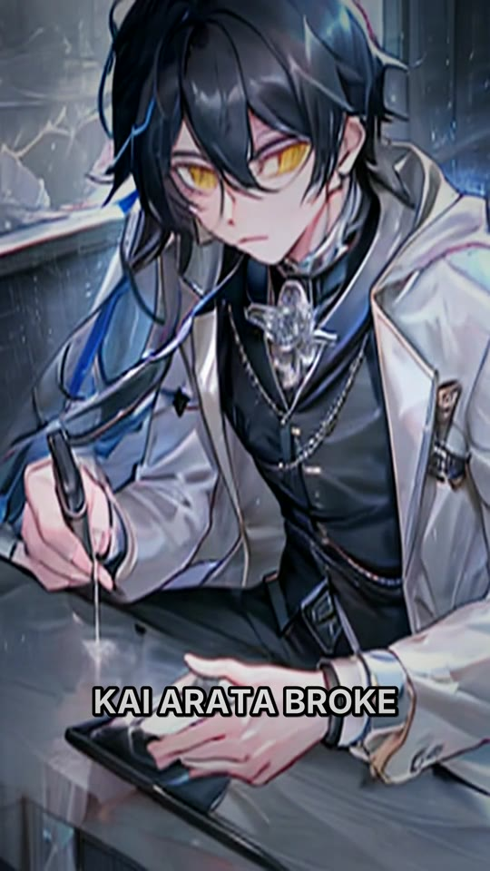
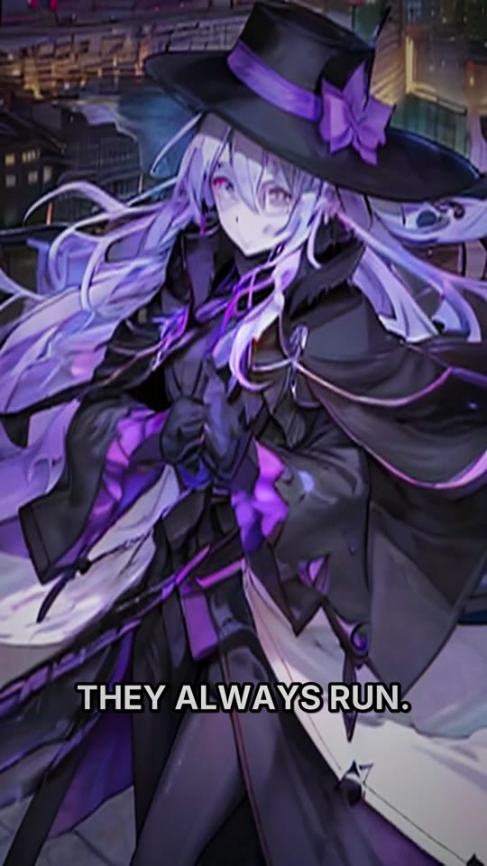

<div align="center">

# ▶ My AI Video Studio

**Idea → original anime episode, superhuman short or documentary — with character memory, episode continuation, English/Japanese voices and a full model-transparency report.**
Every scene is produced by a text‑to‑video model running on free, open‑source weights — **no stock footage, no paid video APIs, no GPU required.**

[Live site](https://my-ai-video-studio-rho.vercel.app) · [Sloth film](outputs/sloth-documentary-1080x1920.mp4) · [Cat cartoon](outputs/cat-knocks-things-over-1080x1920.mp4) · [Architecture](docs/ARCHITECTURE.md) · [Models](docs/MODELS.md) · [Deployment](docs/DEPLOYMENT.md)

 

</div>

## Latest: *The Boy Who Stole Time*
* **Episode 1** (38 s, 9:16): [EN](outputs/boy-who-stole-time-ep1-en-1080x1920.mp4) · [日本語](outputs/boy-who-stole-time-ep1-ja-1080x1920.mp4) · [project .studio.zip](outputs/bundles/boy-who-stole-time-ep1.studio.zip) · [generation report](outputs/reports/btst-ep1-GENERATION_REPORT.md)
* **Episode 2 teaser** — generated *from Episode 1's project file*, same characters/voices/style + a new villain: [video](outputs/boy-who-stole-time-ep2-teaser-1080x1920.mp4) · [project](outputs/bundles/boy-who-stole-time-ep2-teaser.studio.zip) · [report](outputs/reports/btst-ep2-GENERATION_REPORT.md)
* v2 engine vs v1: **4.4× more motion, +47% contrast, native 384×672 (was 288×512), measurable character identity across episodes** — see [PROGRESS](docs/PROGRESS.md) and [QUALITY_EXPERIMENTS](docs/QUALITY_EXPERIMENTS.md).
* Tools & model downloads: [docs/TOOLS_AND_MODELS.md](docs/TOOLS_AND_MODELS.md)

## What it does
`topic → research → script → storyboard → AI video shots → neural narration → original music → edit → validated 1080×1920 MP4`

The first production, **"The Sloth: Master of Nothing"**, is a 2 min 06 s funny nature documentary: 14 scenes, **30 AI‑generated shots**, Kokoro narration, procedurally composed score, cross‑dissolve transitions, burned‑in synced subtitles. A second, shorter cartoon — **"Why Cats Knock Things Over"** (1 min 08 s, 17 shots) — shows the same engine on a funnier, TikTok‑style topic. Both live in [`outputs/`](outputs/) with validation reports and storyboards.

| | |
|---|---|
| Video model | **AnimateDiff‑Lightning** (4‑step distilled) on **ToonYou β6** cartoon checkpoint |
| Voice | **Kokoro‑82M** (ONNX, local) |
| Music | original procedural synth — no licensing risk |
| Editing | FFmpeg: motion‑interpolated slow‑mo, xfade, ducked mix, −16 LUFS, libass subtitles |
| Orchestration | resumable stages, clip quality gates with automatic re‑seed retries, final‑video validator |
| Interfaces | CLI · Claude Code (`/generate-documentary`) · HTTP API + SQLite queue + supervisor · GitHub Actions worker · Vercel site |

## Quick start
```bash
scripts/setup.sh                                   # venv + ~3 GB of weights
cd engine && /opt/studio/venv/bin/python -m studio generate --script ../examples/sloth.json --job sloth
# → data/jobs/sloth/output.mp4   (≈30 min on 4 CPU cores; seconds-per-shot on a GPU)
```
In Claude Code just say: *"Generate a documentary about the octopus"* — see [`.claude/commands`](.claude/commands/generate-documentary.md).

## Honest engineering notes
* **Hardware reality:** built and run on 4 vCPU / 15 GB / no GPU. That's why the model is a distilled 4‑step AnimateDiff, 288×512 native clips (upscaled to 1080×1920) of 2 s each, stretched with interpolation. Bigger models (Wan 2.1, CogVideoX, LTX) are evaluated in [docs/MODELS.md](docs/MODELS.md) and slot into `videogen.py` when a GPU exists.
* **24/7:** the sandbox cannot be a public always‑on worker (no inbound networking, ephemeral). Supervision and crash recovery *were* tested (SIGKILL → restart → job resumed → MP4 served); the externally triggerable worker is GitHub Actions. Details and evidence in [docs/DEPLOYMENT.md](docs/DEPLOYMENT.md).
* **Providers:** LLM/research providers rotate with quota‑aware cooldowns; several were unreachable from the build sandbox's allow‑list and are unit‑tested only — [docs/PROVIDERS.md](docs/PROVIDERS.md) lists exactly which.
* **Fact‑checking:** the demo script was written from verified zoology knowledge; facts are hedged where sources vary.

## Repo map
```
engine/studio/   pipeline, videogen, tts, music, compose, validate, queue, server, supervisor
web/             Vercel front end + serverless API (submit / status / video)
.github/         ci.yml (tests) · claude-generate.yml (on-demand GPU-less worker)
.claude/         slash commands for Claude Code
docs/            ARCHITECTURE · MODELS · PROVIDERS · ENVIRONMENT · INSTALL · DEPLOYMENT · OPERATIONS
examples/        script.json files (sloth.json)
outputs/         finished videos + reports
```

## Licences
Code: MIT. Model weights keep their own licences (AnimateDiff‑Lightning Apache‑2.0, Kokoro Apache‑2.0, ToonYou CreativeML OpenRAIL‑M). Generated music is original. Wikipedia text, when used, is CC BY‑SA and credited in `script.json`.
