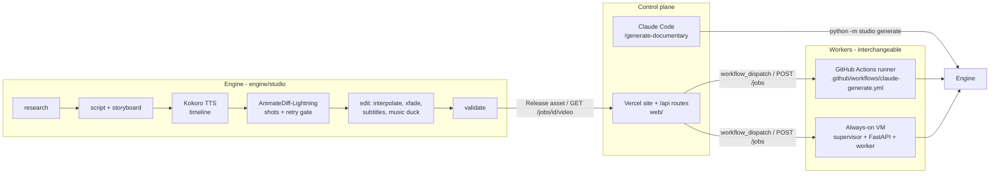

# Architecture



Engine and website are separate deployables: `web/` knows nothing about models; `engine/` knows nothing about HTTP frontends. They meet at one contract — *submit job → poll status → fetch MP4*.

## Stages (all resumable; artefacts cached in `data/jobs/<id>/`)

| # | Stage | Module | Output | Gate |
|---|---|---|---|---|
| 1 | Research | `research.py`, `providers.py` | `research.json` | sources credited |
| 2 | Script | `scriptwriter.py` | `script.json` | schema check (narration + ≥1 shot per scene) |
| 3 | Voice + timeline | `tts.py`, `pipeline.stage_voice` | `audio/scene_*.wav`, `timeline.json` | — |
| 4 | Storyboard | `pipeline.stage_storyboard` | `storyboard.json` | shots per scene = ⌈scene time / 5 s⌉ |
| 5 | **AI video** | `videogen.py` | `clips/shot_*.mp4` | **clip validator** (brightness, contrast, motion, NaN) → re-seed up to 3× |
| 6 | Edit | `compose.py` | `output.mp4` | 2× slow-mo interpolation, 24 fps, 1080×1920, xfade, vignette, ASS subtitles, ducked music, −16 LUFS |
| 7 | Validate | `validate.py` | `report.json` | h264, audible, duration ≈ narration ±3 s |

Resumability: every stage first checks for its artefact, so re-running the same job id after a crash continues at the first missing shot.

## Script schema
```json
{ "title": "…", "mood": "playful|wonder|tense", "voice": "af_heart|bf_emma|bm_george|…",
  "scenes": [ { "narration": "≤32 words, spoken", "shots": [ { "prompt": "one moving scene: subject, action, setting, camera" } ] } ],
  "credits": ["source urls"] }
```

## Timing model
`timeline.json` fixes when each sentence starts (lead-in 1 s, 0.45 s gaps, 2.2 s outro). Each scene owns the span from its start to the next scene's start; that span is divided evenly between its shots, and each shot clip is rendered `slot + 0.5 s` long so the 0.5 s cross-dissolves stay on the narration clock. Subtitles are laid out by distributing each sentence's measured duration across ≤4-word chunks by character weight.

## Queue & API (always-on mode)
`queue.py` — SQLite WAL; statuses `queued → running → done|done_with_warnings|failed`; `recover()` re-queues jobs interrupted by a crash (max 3 attempts).
`server.py` — `POST /jobs`, `GET /jobs`, `GET /jobs/{id}`, `GET /jobs/{id}/video`, `GET /health` (worker heartbeat). Bearer `STUDIO_API_KEY`.
`supervisor.py` — keeps API + worker alive with exponential backoff.

## Security
* Engine API refuses to start serving jobs without `STUDIO_API_KEY`; constant-time compare.
* The Vercel submit route requires `SUBMIT_PASSCODE` — compute is the expensive resource.
* The engine API key and GitHub token only exist in Vercel server-side env; the browser never sees them.
* No weights, keys or job data are committed (`.gitignore`).
