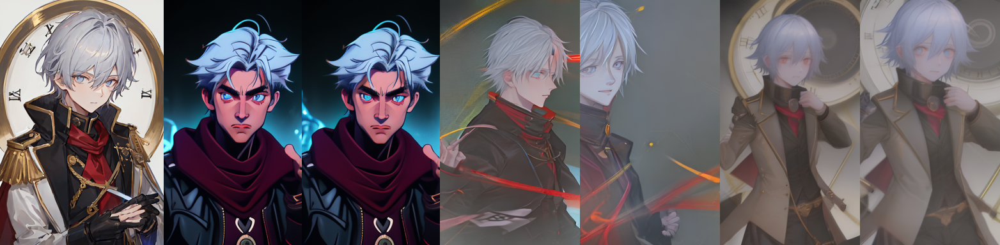
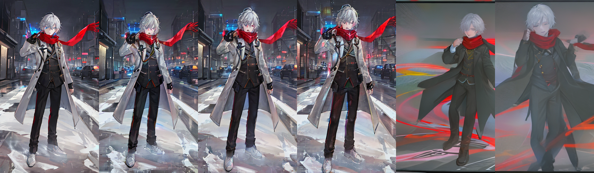

# Quality experiments (all measured on this machine: 4 vCPU Xeon w/ AVX512-BF16, 15 GB RAM, no GPU)

Same scene, same seed (4242): *silver-haired anime hero raising his hand as time freezes, neon street at night*.
Metrics: **motion** = mean abs gray-level frame difference (8 fps); **id_sim** = cosine similarity of CLIP ViT-H embeddings (frame 8 vs character reference); plus visual review of first/last frames.

## Experiment 1 — base model, camera LoRA, IP-Adapter (`scripts/quality_experiment.py`)
 (left→right: reference keyframe · A f0/f15 · B f0/f15 · C f0/f15)

| Run | Native | Motion | id_sim | Visual verdict |
|---|---|---|---|---|
| A baseline ToonYou t2v | 288×512 | 3.38 | 0.61 | static; 3D-cartoon, not anime; identity loose |
| B Counterfeit t2v + zoom-in LoRA | 384×672 | 24.2 | 0.78 | real camera motion, anime look, **but washed-out, scene lost (no neon street), face drifts** |
| C = B + IP-Adapter-Plus 0.6 | 384×672 | 12.2 | 0.78 | identity strong, but copies the reference's background; washed-out |

Lesson: motion numbers alone mislead (B's motion is partly smear). 4-step t2v on an anime checkpoint loses contrast and prompt adherence.

## Experiment 2 — multi-stage keyframe → image-to-video (`scripts/quality_experiment2.py`)
 (left: E keyframe + 3 animated frames · right: D t2v f0/f15)

| Run | Visual verdict |
|---|---|
| D = B with LoRA 0.5 + contrast tags | still washed/abstract (contrast 40) |
| **E keyframe (18-step DPM++) → AnimateDiff-Lightning v2v, strength 0.65, zoom LoRA 0.5** | **correct scene, detailed neon background, stable identity across 16 frames, scarf/coat motion + camera push-in** |

**Decision:** anime/superhuman/story modes use E (`method: i2v`). Documentary keeps t2v on ToonYou (regression-safe).

## Performance engineering (found while scaling E)
| Problem | Measurement | Fix |
|---|---|---|
| OOM (killed at 14 GB) | VAE encode of 16 frames + duplicate UNets | `decode_chunk_size=2`; image and video pipelines never co-resident |
| 9.1 GB resident after load | UNetMotionModel build leaves a fp32 temp copy in glibc heap; duplicate MotionAdapter | `malloc_trim(0)`, drop `motion_adapter` after merge → peak 9.9 GB |
| **i2v 433 s/shot** | `AnimateDiffVideoToVideoPipeline.from_pipe()` silently cast the shared UNet to **fp32** (15.5 → 74.6 s/step) | `from_pipe(..., torch_dtype=bf16)` → **116 s/shot (3.7× faster)** |
| per-step cost vs resolution (t2v, 16 frames, bf16) | 288×512 8.2 s · 320×576 9.8 s · 352×624 12.1 s · 384×672 16.3 s | 384×672 is affordable → new native default for 9:16 |
| VAE dtype | bf16 decode 2.1 s/frame vs fp32 7.7 s/frame | keep bf16, disable `force_upcast` |

## Speech intelligibility (automatic listening with Whisper-base)
| Line | Voice | Error |
|---|---|---|
| "Time stopped. Nobody moves. Except him." | am_puck (EN) | WER 0.17 (heard "Time stop, nobody moves except him.") |
| 「時間が止まった。誰も動かない。でも、あの男だけは…動いている。」 | jm_kumo (JA, misaki G2P) | CER 0.00 |

## Next experiments
* RIFE vs minterpolate for 8→24 fps; Real-ESRGAN ×2 on keyframes before animation (cost/benefit).
* IP-Adapter on keyframes at 0.35–0.5 (identity without copying background) — measured in the Episode-1 build.
* SparseCtrl / AnimateLCM as alternative motion models.
